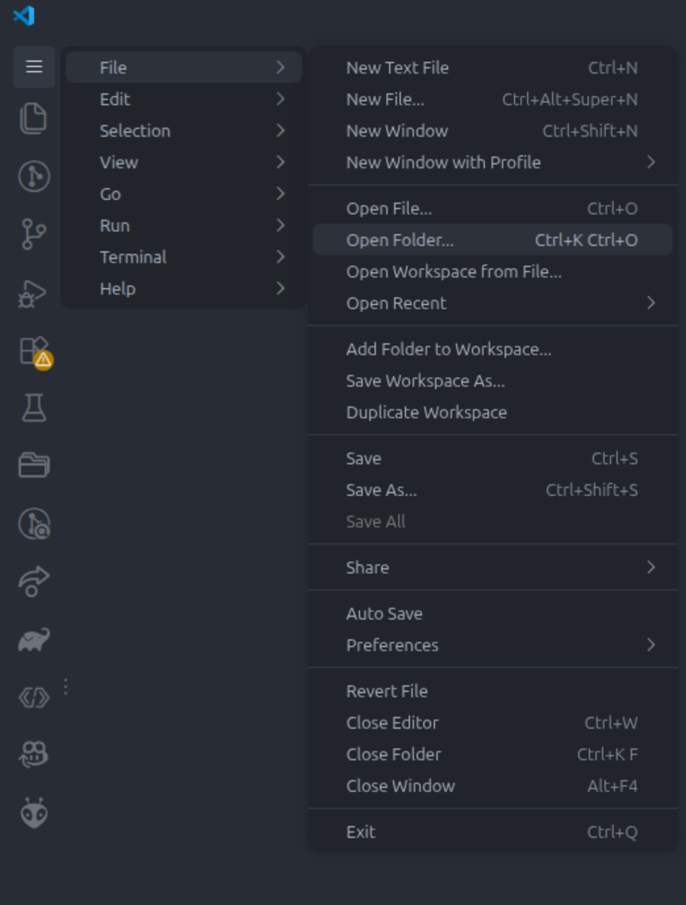
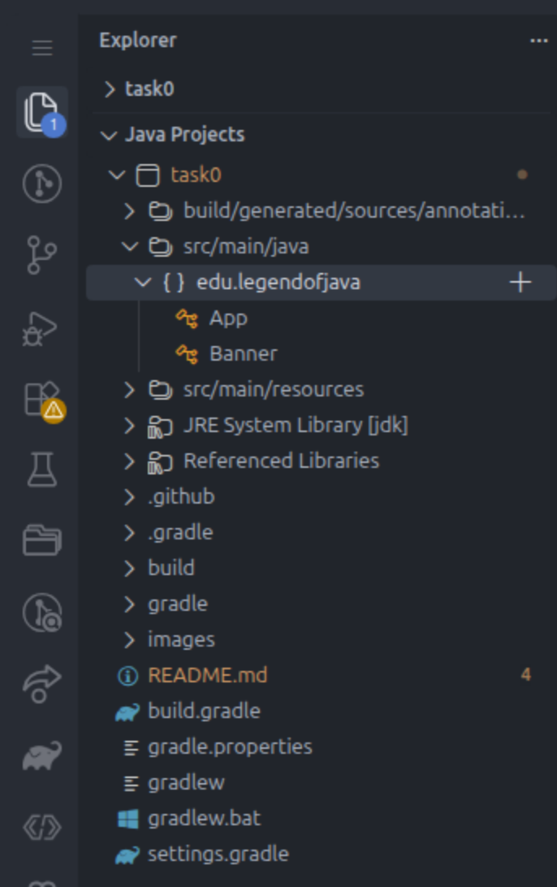
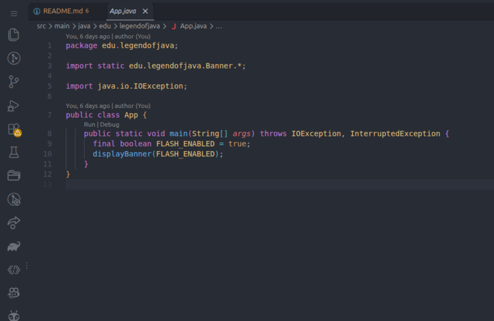
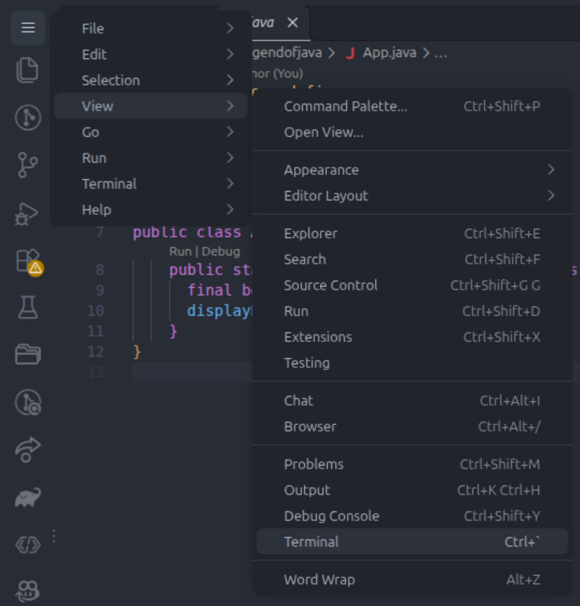
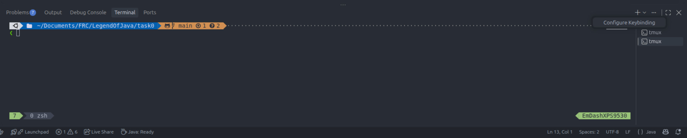
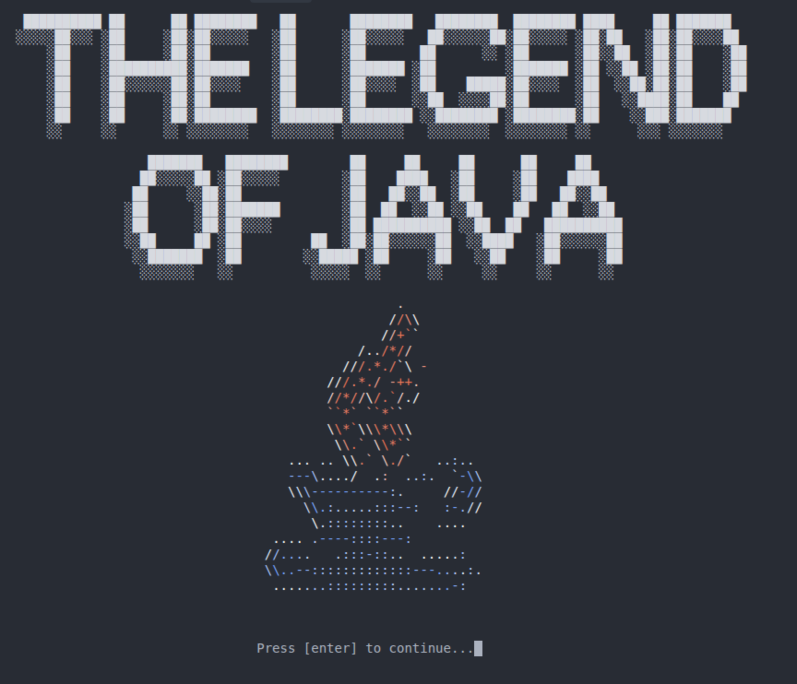

# Task 0

## Downloading WPILib 

These tutorials use **WPILib 2027** (Commands v3). It's still in **alpha**, so get it from GitHub, not the normal docs page:

1. Go to https://github.com/wpilibsuite/allwpilib/releases and find **v2027.0.0-alpha-8**.
2. Under **Assets**, download the installer for your computer:
   | Computer          | File                                       |
   | ----------------- | ------------------------------------------ |
   | Windows           | `WPILib_Windows-x64-2027.0.0-alpha-8.iso`  |
   | Mac (M1/M2/M3/M4) | `WPILib_macOS-Arm64-2027.0.0-alpha-8.dmg`  |
   | Mac (Intel)       | `WPILib_macOS-Intel-2027.0.0-alpha-8.dmg`  |
   | Linux             | `WPILib_Linux-x64-2027.0.0-alpha-8.tar.gz` |

   Needs Windows 11, macOS 15+, or Ubuntu 26.04. **Mac:** run `xcode-select --install` first.
3. Run it and pick **Everything**. It installs next to any older WPILib, so it won't break anything.
4. Open **WPILib VS Code 2027** (not the 2026 one, and not plain VS Code).

> [!INFO] If a newer 2027 alpha/beta is out, ask a mentor before using it. Things can change between versions.

## Clone the Repository

Next clone the repository:

```bash
git clone https://github.com/EmDash00/TheLegendOfJava.git
```

## Configure VSCode

Then, open the task0 folder in VSCode.



In the explorer sidebar, minimize "task0" and open up "Java Projects". Then expand `src/main/java` and `edu.legendofjava`.




Click on `App` and you should see the following screen:



Next, open the terminal by going to `View > Terminal`.



You should then see a terminal appear in the bottom of your screen. Yours will probably look different than mines. Then, set a keybind to maximize the terminal by right-clicking .



Double click on the `Keybinding` column then type ``Shift + Ctrl/Cmd + ` ``. Press enter to accept the keybind.


## Running the Code

Maximize the terminal using ``Shift + Ctrl/Cmd + ` ``. Then to run the code use:

```bash
./gradlew run
```

You should see the "Legend of Java" banner pop up.



Unmaximize the terminal by pressing ``Shift + Ctrl/Cmd + ` ``.

## Printing to the Screen

In Java, we can print to the screen using `System.out.println()`. For example:

```java
System.out.println("Hello, world!");
```

Prints `Hello, world!`. The quotation marks tell Java that what's in between them should be interpretted as text, not code.

> [!NOTE]
> In Java we must end each line with a ;. You can think about them like periods in English.

> [!NOTE]
> "Text" in a computer is called a "string" as in a "string of characters".

We can also do multi-line strings like so:

```java
   System.out.println("""
I am a multiline string.
""");
```
> [!NOTE]
> Multiline strings keep indentation, so make sure the line after the first """ doesn't have any!

Now it's your turn. Use `System.out.println()` to add the following intro text after the line that says `displayBanner()`.

```
Long ago, the programming nations lived in harmony, but everything changed when
the HACKERs attacked. Only the DEVELOPER, master of all programming languages, 
could stop them. But when the world needed them most, the vanished.

Without the DEVELOPER to keep the peace, the HACKERs took over and the world, 
descended into DARK AGE. 

Despite everything, the legend of the DEVELOPER survived on the wind's breath.
To this day, the people still believe that the DEVELOPER will return.

Only time will tell if they do...
```

<details>
<summary> Solution </summary> 

```java

System.out.println("""
Long ago, the programming nations lived in harmony, but everything changed when
the HACKERs attacked. Only the DEVELOPER, master of all programming languages, 
could stop them. But when the world needed them most, the vanished.

Without the DEVELOPER to keep the peace, the HACKERs took over and the world, 
descended into DARK AGE. 

Despite everything, the legend of the DEVELOPER survived on the wind's breath.
To this day, the people still believe that the DEVELOPER will return.

Only time will tell if they do...
""");

```

</details>  <br>