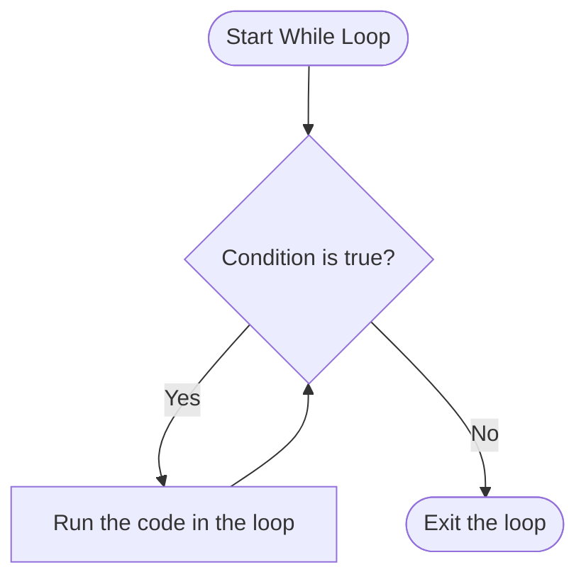
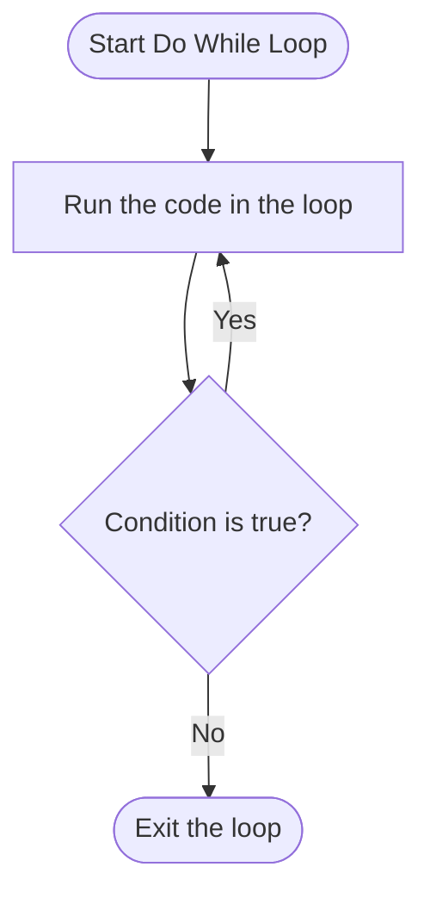

# Task 2: Control Flow

Now that we can get input and give output, we need to learn how to process it. Computers make decisions all the time and this task will teach you how to do so.

## If Statements

One of the most basic ways a computer can make a statement is using the `if` statement. This checks if a condition is true and then does a thing if it does.

```java
if (condition) {
    System.out.println("Condition is true");
}
```

This will print `"Condition is true"` if the condition in the parenthesis is true. We can also have multiple conditions:

```java
if (condition1) {
    System.out.println("Condition1 is true");
}
else if (condition2) {
    System.out.println("Condition2 is true");
}
else if (condition3) {
    System.out.println("Condition3 is true");
}
else {
    System.out.println("None of the conditions are true");
}
```

This will check if condition1 is true, printing if it is. Then it will check condition 2, printing if it is. Then it will check condition3, printing if it is. If none of them are true, the code surrounded by the `{ }` in the else will be run.

How can we form conditions? Using *boolean operators*. 

>[!TIP]
>A boolean is a value that is either true or false. You can think of it as the answer to a yes/no question.

| Type of Boolean Operator | Syntax     | True if                          |
| ------------------------ | ---------- | -------------------------------- |
| and                      | `A && B`   | A and B are both true            |
| or                       | `A \|\| B` | At least one of A and B is true. |
| not                      | `!A`       | A is false.                      |
| equal to                 | `A == B`   | A and B are equal                |
| not equal to             | `A != B`   | A and B or not equal             |
| Less than                | `A < B`    | A is less than B                 |
| Less than or equal to    | `A <= B`   | A is less than or equal to B     |
| Greater than             | `A > B`    | A is greater than B              |
| Greater than or equal to | `A >= B`   | A is greater than or equal to B  |

## Loops

Sometimes, computers need to do some actions repeatedly. For example, a computer may keep asking you for a number if you refuse to provide one (useful for what we'll be adding to the game next). To do so we need to use *loops*. Loops are like `if` statements, but instead of running code between `{ }` just once, it runs them repeatedly until or while some condition is true. 

There are two types to know for now. Below is the syntax and flowcharts for each one.

```java
while (condition) {

}
```



```java
do {

} while (condition);
```



>[!NOTE]
>If the condition is not true the first time it is checked for a `while` loop, the loop never runs. This can be useful sometimes.

>[!WARNING]
>Don't forget the semicolon after the while in a `do ... while` loop. It's a common mistake!

## try... catch...

Another important concept we need to learn before proceeding is called *exceptions*. An exception is anything the computer does not expect to happen (for example if you try to use `Integer.parseInt()` on a string with no numbers). You can think about them like errors.

The `try... catch...` statement allows us to decide how to handle errors. If we don't "catch" an error, the program will crash.

In the following example, the code inside the braces after the `try` will be attempted. If a `NumberFormatException` occurs, the code in the braces after the `catch` will run. In this case, since `Integer.parseInt()` will fail, the catch runs and prints `"I need a number."`.


```java
try {
    int x = Integer.parseInt("no numbers");
}
catch (NumberFormatException e) {
    System.out.println("I need a number.");
}
```

## Character creation

Combining these three control elements will allow us to create a character creation tool. Most RPGs allow the player to select a distribution of traits. We'll be using the DnD 5e traits here, which has traits:
- Strength
- Dexterity
- Constitution
- Intelligence
- Wisdom
- Charisma

For this game, we will give the player 60 skill points to assign. Players will be given the option to assign skill points in the order I gave in the list above. When they assign skillpoints, the total number of *remaining points* they have goes down. They can only assign up to the points they have remaining to a trait. For example: player assigns 50 points to strength and has 10 points remaining to use for all other remaining traits. Once all traits have been assigned, the creator should ask the player if they are satisfied. If they are, satisfied, the creation finishes; otherwise, the creator restarts. 

Example behavior:

```
Tell be me about yourself.
Strength (60 points remaining): 15
Dexterity (45 points remaining): 15
Constitution (30 points remaining): 5
Intelligence (25 points remaining): 15
Wisdom (10 points remaining): 5
Charisma (5 points remaining): 5

Your stats:
Strength: 15    Dexterity: 15   Constitution: 5     Intelligence: 15    Wisdom: 5   Charisma: 5

Are you satisfied with your character? (y/n): y
```

Let's get started. Below the last line of code you previously wrote before `scanner.close()` we need to make variables for each of the skillpoints. The skillpoints are integers. Remember, to make a variable you can use `[type of variable] [name of variable]`.

Next, we can make a loop obtain the user's desired skillpoints. For strength it looks like this:

```java
System.out.println("Tell me about yourself.");

while (true) {
    System.out.print("Strength (60 points remaining): ");
    String input = scanner.nextLine();
    try {
        int assignment = Integer.parseInt(input);
        if (assignment >= skillPointsRemaining) {
            continue;
        }
        strength = assignment;
        skillPointsRemaining -= assignment;
        break;
    }
    catch (NumberFormatException e) {
        
    }
}   
```

>[!NOTE]
`while (true)` loops forever normally.

>[!NOTE]
>`break` breaks you out of a loop and `continue` forcibly continues it from the top. The try catch block tries to convert the string input. If an error happens or you try to assignment it will just ask again; otherwise, it will break out of the loop.

>[!NOTE]
`a -= b` is a quick way to write `a = a - b`. There are variants like `+=`, `*=` and `/=` as well.


We'll need to do this for the next few stats. Make sure you make a variable also to keep track of the total remaining skill points called `skillPointsRemaining`. Make sure you change the number of skillpoints remaining and change the print for each dialogue. We can do this just by repeating the code but changing the print for each skill and what skill is assigned to.

<details>
<summary> Solution </summary> 

```java
System.out.println("Tell me about yourself.");

while (true) {
    System.out.print("Strength (60 points remaining): ");
    String input = scanner.nextLine();
    try {
        int assignment = Integer.parseInt(input);
        if (assignment >= skillPointsRemaining) {
            continue;
        }
        strength = assignment;
        skillPointsRemaining -= assignment;
        break;
    }
    catch (NumberFormatException e) {
        
    }
}   

while (true) {
    System.out.print("Dexterity " + skillPointsRemaining + " points remaining): ");
    String input = scanner.nextLine();
    try {
        int assignment = Integer.parseInt(input);
        if (assignment >= skillPointsRemaining) {
            continue;
        }
        dexterity = assignment;
        skillPointsRemaining -= assignment;
        break;
    }
    catch (NumberFormatException e) {
        
    }
}  

while (true) {
    System.out.print("Constitution " + skillPointsRemaining + " points remaining): ");
    String input = scanner.nextLine();
    try {
        int assignment = Integer.parseInt(input);
        if (assignment >= skillPointsRemaining) {
            continue;
        }
        constitution = assignment;
        skillPointsRemaining -= assignment;
        break;
    }
    catch (NumberFormatException e) {
        
    }
}

while (true) {
    System.out.print("Intelligence " + skillPointsRemaining + " points remaining): ");
    String input = scanner.nextLine();
    try {
        int assignment = Integer.parseInt(input);
        if (assignment >= skillPointsRemaining) {
            continue;
        }
        intelligence = assignment;
        skillPointsRemaining -= assignment;
        break;
    }
    catch (NumberFormatException e) {
        
    }
}

while (true) {
    System.out.print("Wisdom " + skillPointsRemaining + " points remaining): ");
    String input = scanner.nextLine();
    try {
        int assignment = Integer.parseInt(input);
        if (assignment >= skillPointsRemaining) {
            continue;
        }
        wisdom = assignment;
        skillPointsRemaining -= assignment;
        break;
    }
    catch (NumberFormatException e) {
        
    }
}

while (true) {
    System.out.print("Charisma " + skillPointsRemaining + " points remaining): ");
    String input = scanner.nextLine();
    try {
        int assignment = Integer.parseInt(input);
        if (assignment >= skillPointsRemaining) {
            continue;
        }
        charisma = assignment;
        skillPointsRemaining -= assignment;
        break;
    }
    catch (NumberFormatException e) {
        
    }
}
```
</details>  <br>

Finally, we just print out the assigned statline with tabs bewteen each stat and ask if the user is satisfied. Use a loop to check if the user entered a `y` or `n` and repeat the question otherwise.

>[!NOTE]
>Checking strings is a little differen than the rest of the variable types. To check if two strings are equal we do `str.equals("equal")`. This checks if string `str` is equal to the string `"equal"`.

<details>
<summary> Solution </summary> 

```java
System.out.println("Your stats:");
System.out.println("Strength: " + strength + "\tDexterity: " + dexterity + "\tConstitution: " + constitution + "\tIntelligence: " + intelligence + "\tWisdom: " + wisdom + "\tCharisma: " + charisma);
System.out.println();

String yn;
while (true) {
    System.out.print("Are you satisfied with your stats? (y/n):");
    yn = scanner.nextLine();

    if (yn.equals("y") || yn.equals("n")) {
        break;
    }
}
```
</details>

To make the entire character assignment repeat, we can just wrap the entire thing in a `do ... while` loop. Make a boolean variable called `assigningStats` at the top then set it to true if yn is `"n"` and false if yn is `"y"`.

<details>
<summary> Solution </summary> 

```java
System.out.println("Tell me about yourself.");

boolean assigningStats;
do {
    while (true) {
        System.out.print("Strength (60 points remaining): ");
        String input = scanner.nextLine();
        try {
            int assignment = Integer.parseInt(input);
            if (assignment >= skillPointsRemaining) {
                continue;
            }
            strength = assignment;
            skillPointsRemaining -= assignment;
            break;
        }
        catch (NumberFormatException e) {
            
        }
    }   

    // other stats...

    System.out.println("Your stats:");
    System.out.println("Strength: " + strength + "\tDexterity: " + dexterity + "\tConstitution: " + constitution + "\tIntelligence: " + intelligence + "\tWisdom: " + wisdom + "\tCharisma: " + charisma);
    System.out.println();

    String yn;
    while (true) {
        System.out.print("Are you satisfied with your stats? (y/n):");
        yn = scanner.nextLine();

        if (yn.equals("y") || yn.equals("n")) {
            break;
        }
    }

    assigningStats = yn.equals("n");
} while (assigningStats);
```
</details>
