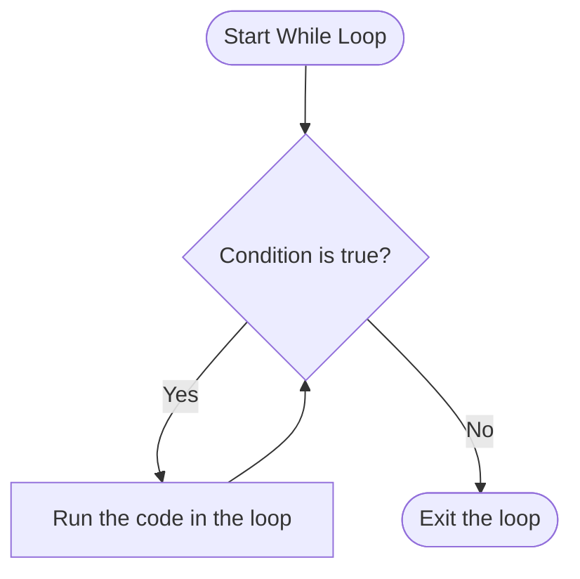
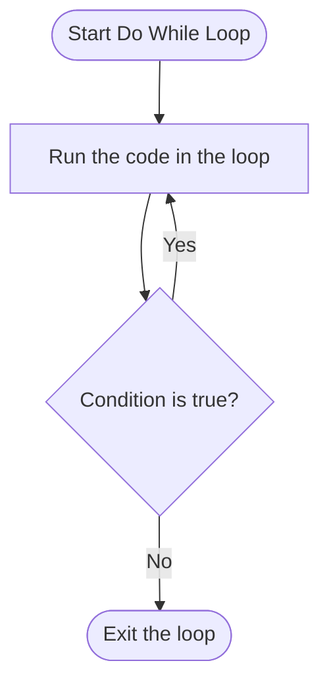

# Task 2: Control Flow

Now that we can get input and give output, we need to learn how to process it. Computers make decisions all the time and this task will teach you how to do so.

## If Statements

One of the most basic ways a computer can make a statement is using the `if` statement. This checks if a condition is true and then does a thing if it does.

```java
if (condition) {
    System.out.println("Condition is true");
}
```

This will print `"Condition is true"` if the condition in the parenthesis is true. We can also have multiple conditions:

```java
if (condition1) {
    System.out.println("Condition1 is true");
}
else if (condition2) {
    System.out.println("Condition2 is true");
}
else if (condition3) {
    System.out.println("Condition3 is true");
}
else {
    System.out.println("None of the conditions are true");
}
```

This will check if condition1 is true, printing if it is. Then it will check condition 2, printing if it is. Then it will check condition3, printing if it is. If none of them are true, the code surrounded by the `{ }` in the else will be run.

How can we form conditions? Using *boolean operators*. 

>[!TIP]
>A boolean is a value that is either true or false. You can think of it as the answer to a yes/no question.

| Type of Boolean Operator | Syntax     | True if                          |
| ------------------------ | ---------- | -------------------------------- |
| and                      | `A && B`   | A and B are both true            |
| or                       | `A \|\| B` | At least one of A and B is true. |
| not                      | `!A`       | A is false.                      |
| equal to                 | `A == B`   | A and B are equal                |
| not equal to             | `A != B`   | A and B or not equal             |
| Less than                | `A < B`    | A is less than B                 |
| Less than or equal to    | `A <= B`   | A is less than or equal to B     |
| Greater than             | `A > B`    | A is greater than B              |
| Greater than or equal to | `A >= B`   | A is greater than or equal to B  |

## Loops

Sometimes, computers need to do some actions repeatedly. For example, a computer may keep asking you for a number if you refuse to provide one (useful for what we'll be adding to the game next). To do so we need to use *loops*. Loops are like `if` statements, but instead of running code between `{ }` just once, it runs them repeatedly until or while some condition is true. 

There are two types to know for now. Below is the syntax and flowcharts for each one.

```java
while (condition) {

}
```



```java
do {

} while (condition);
```



>[!INFO]
>If the condition is not true the first time it is checked for a `while` loop, the loop never runs. This can be useful sometimes.

>[!WARNING]
>Don't forget the semicolon after the while in a `do ... while` loop. It's a common mistake!

## try... catch...

Another important concept we need to learn before proceeding is called *exceptions*. An exception is anything the computer does not expect to happen (for example if you try to use `Integer.parseInt()` on a string with no numbers). You can think about them like errors.

The `try... catch...` statement allows us to decide how to handle errors. If we don't "catch" an error, the program will crash.

In the following example, the code inside the braces after the `try` will be attempted. If a `NumberFormatException` occurs, the code in the braces after the `catch` will run. In this case, since `Integer.parseInt()` will fail, the catch runs and prints `"I need a number."`.


```java
try {
    int x = Integer.parseInt("no numbers");
}
catch (NumberFormatException e) {
    System.out.println("I need a number.");
}
```


